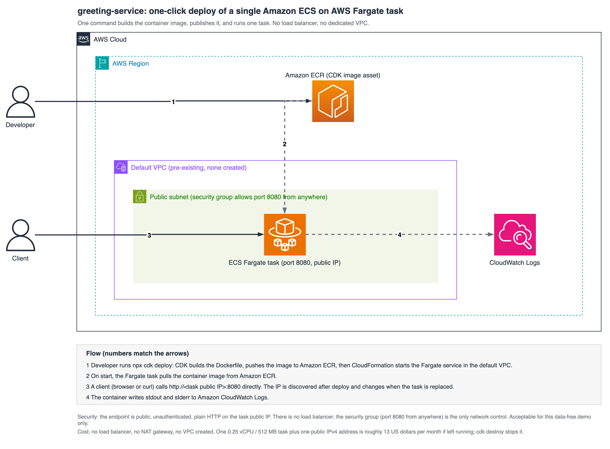

# greeting-service

A small Spring Boot REST service used as the sample application for the AWS blog
on limiting agent permissions and spend in AWS Transform custom. It exists to
give AWS Transform custom a real, self-contained codebase to upgrade: the starting
point is Java 8 / Spring Boot 1.5, and the transformed result targets Java 17 /
Spring Boot 3.2 (`javax` to `jakarta`, JUnit 4 to JUnit 5).

The single endpoint is deliberately minimal so the transformation, not the
business logic, is the focus.

> **Reference sample, not production-hardened.** The application dependencies
> are intentionally outdated (see [Security posture](#security-posture)), and
> the optional AWS deployment publishes a public, unauthenticated endpoint over
> plain HTTP on the task's public IP. The demo service holds no data.
> Use a personal or sandbox AWS account.

## Architecture



One command (`npx cdk deploy` from `infra/`) builds the container image from
the `Dockerfile`, pushes it to the CDK-managed ECR repository, and runs a
single ECS Fargate task with a public IP in your account's default VPC. There
is no load balancer and no dedicated VPC: the deployed endpoint only proves
the application runs on AWS, and this repository exists for the transformation
experiment, so the infrastructure is kept as small as a working one-click
deploy allows. The editable source is `docs/images/architecture.drawio`.

## What it does

```
GET /api/greeting?name=<name>   ->   {"id": <n>, "content": "Hello, <name>!"}
```

The service is a standard Spring Boot web application. It runs on an embedded
Tomcat server and listens on port `8080`. There is no external datastore and no
cloud dependency, so it builds and runs the same on a laptop, in a container, or
in CI.

## Security posture

The `main` branch intentionally ships a **legacy dependency set**: Spring Boot
1.5.22 pins jackson-databind 2.8.x, embedded Tomcat 8.5.x, Spring 4.3.x, and
logback 1.1.x, all of which carry known CVEs. This is by design, not neglect:
the outdated application is the *input* to AWS Transform custom, and the
transformation to Java 17 / Spring Boot 3.2 resolving those findings is the
result the accompanying blog post demonstrates. Dependency scanners will
flag the `main` branch; the transformed branch is the fix.

Do not deploy the `main` state anywhere it can receive untrusted traffic. The
infrastructure code under `infra/` carries no known vulnerabilities and is kept
current independently.

## Prerequisites

To build and run locally:

- A JDK. The "before" state builds on Java 8; the transformed state builds on
  Java 17. See `.java-version`.
- Maven 3.6+.

To run the transformation (the point of this repository):

- **The AWS Transform CLI (`atx`).** Install it with the official script:

  ```bash
  # Linux and macOS
  curl -fsSL https://transform-cli.awsstatic.com/install.sh | bash

  # Windows, from Windows Terminal using PowerShell
  irm https://transform-cli.awsstatic.com/install.ps1 | iex
  ```

  Then confirm it is on your PATH:

  ```bash
  atx --version
  ```

  The confirmation runs in this README used **AWS Transform CLI 3.10.0**; the
  first discovery run, the one that raised 23 approval prompts, used 3.9.0.

- **Node.js 22 or later.** This is the CLI's own requirement, and it is a
  higher bar than the CDK deploy below, so installing 22+ covers both.
- **Git**, with the working directory a valid Git repository. Cloning this
  repository satisfies that; the transformation commits its intermediate steps,
  so it will not run outside a repo.
- **AWS credentials** with permission to call AWS Transform custom. For a first
  run the simplest choice is the `AWSTransformCustomFullAccess` managed policy.
  Two narrower policies exist and are the ones worth using once you are past
  setup: see [Control 2](#control-2-separate-the-identity-that-runs-from-the-identity-that-authors),
  which is a large part of what this repository is about.
- **A supported region.** AWS Transform custom runs in `us-east-1`,
  `eu-central-1`, `eu-west-2`, `ca-central-1`, `ap-northeast-1`,
  `ap-northeast-2`, `ap-southeast-2`, and `ap-south-1`. The CLI resolves the
  region the usual way (`AWS_REGION`, then `AWS_DEFAULT_REGION`, then your
  profile, then a `us-east-1` fallback) and fails with a clear message if it
  lands on an unsupported one. Check yours with `aws configure get region`.
- **Network egress**, if you are on a restricted network. The CLI needs
  `transform-cli.awsstatic.com` (installer and updates),
  `transform-custom.<region>.api.aws` (the service endpoint), and
  `*.s3.amazonaws.com` reachable.

Additionally, to deploy the sample app to AWS (optional, and not part of the
transformation story):

- An AWS account and credentials configured (`aws configure` or SSO)
- Node.js 18+ (already covered if you installed 22+ above)
- Docker (or a Docker-compatible builder such as Finch, via `CDK_DOCKER`)

> **Platform note:** every command in this README was verified on **macOS**.
> On Linux, set `JAVA_HOME` to your JDK 8 path directly (the
> `/usr/libexec/java_home` helper is macOS-only) and expect
> `guardrails/trust-settings.yaml` to need one or two extra entries: its
> JDK-probe patterns are macOS paths, and the file's header explains how to
> add the command shape a prompt names. The CLI itself supports Linux, macOS,
> native Windows, and WSL, but the commands here were not run on Windows.

## Quick start

1. **Clone the repository:**

   ```bash
   git clone https://github.com/aws-samples/sample-guardrails-for-aws-transform-custom.git && cd sample-guardrails-for-aws-transform-custom
   ```

2. **Build and test locally.** The `main` tree requires JDK 8, so pin it
   explicitly (Spring Boot 1.5 cannot start its context on JDK 9+):

   ```bash
   JAVA_HOME=$(/usr/libexec/java_home -v 1.8) mvn clean verify
   ```

   This compiles the service, runs the unit tests, and produces an executable
   jar at `target/greeting-service-1.0.0.jar`.

3. **Run it locally:**

   ```bash
   JAVA_HOME=$(/usr/libexec/java_home -v 1.8) mvn spring-boot:run
   # or: JAVA_HOME=$(/usr/libexec/java_home -v 1.8) java -jar target/greeting-service-1.0.0.jar
   ```

   Then verify:

   ```bash
   curl "http://localhost:8080/api/greeting?name=World"
   # {"id":1,"content":"Hello, World!"}
   ```

4. **(Optional) Deploy to AWS.** First time in an account/region, bootstrap
   the CDK once:

   ```bash
   cd infra
   npm install
   npx cdk bootstrap
   ```

   Then deploy:

   ```bash
   npx cdk deploy
   ```

   The deploy builds the image from the `Dockerfile`, pushes it to the
   CDK-managed ECR repository, and starts the Fargate service in your
   account's default VPC. With the image build cached, the stack deploys in
   about 90 seconds (measured); the first run also builds the Maven image,
   which adds a few minutes.

5. **Verify the deployment.** Without a load balancer there is no stable DNS
   name; the endpoint lives on the task's public IP. Fetch it and call the
   service (the cluster and service names are fixed by the stack, so this is
   copy-paste):

   ```bash
   TASK_ARN=$(aws ecs list-tasks --cluster greeting-service-demo \
     --service-name greeting-service --query 'taskArns[0]' --output text)
   ENI_ID=$(aws ecs describe-tasks --cluster greeting-service-demo --tasks "$TASK_ARN" \
     --query "tasks[0].attachments[0].details[?name=='networkInterfaceId'].value | [0]" --output text)
   PUBLIC_IP=$(aws ec2 describe-network-interfaces --network-interface-ids "$ENI_ID" \
     --query 'NetworkInterfaces[0].Association.PublicIp' --output text)
   curl "http://$PUBLIC_IP:8080/api/greeting?name=World"
   # {"id":1,"content":"Hello, World!"}
   ```

   The IP changes whenever the task is replaced; re-run the commands to
   rediscover it.

6. **Clean up** when you are done, to stop the idle cost (roughly $13 per
   month while the stack runs):

   ```bash
   npx cdk destroy
   ```

   One residue remains by design: the container image stays in the
   CDK-bootstrap ECR repository (`cdk destroy` never removes bootstrap
   assets). Storage for it costs about a cent per month; delete the image
   from the `cdk-*-container-assets-*` repository if you want zero trace.

## Running the transformation with guardrails

This is the part the accompanying blog post demonstrates: upgrading this
repository with [AWS Transform custom](https://aws.amazon.com/transform/)
while limiting what the agent may do and spend, instead of granting blanket
trust.

### Control 1: Scope which tools run without asking

Running the `AWS/java-version-upgrade` transformation on this repository with no
trust configuration raises 23 approval prompts; blanket-trusting everything with
`--trust-all-tools` removes the prompts and the guardrail. The middle path is
[`guardrails/trust-settings.yaml`](guardrails/trust-settings.yaml), a minimal
allowlist derived by running the transformation and recording every prompt it
raised. With it in place, a full run completes with **zero prompts and no
blanket trust**: 43 tool invocations all trusted, build green, 2 of 2 tests
passing. Copy it into place and run interactively:

```bash
mkdir -p ~/.aws/atx
cp guardrails/trust-settings.yaml ~/.aws/atx/trust-settings.yaml
atx custom def exec -n AWS/java-version-upgrade -p . \
  -c "JAVA_HOME=$(/usr/libexec/java_home -v 1.8) mvn clean verify"
```

The `mkdir -p` matters on a fresh install: `~/.aws/atx/` does not exist until
the CLI has run at least once, so the copy fails without it. If you have not
installed the CLI yet, see [Prerequisites](#prerequisites).

The validation command pins JDK 8 because the "before" tree cannot start on
JDK 9+, which is also why the allowlist carries `JAVA_HOME=* mvn *` patterns:
trusted patterns match the full command string, so an env-prefixed command
needs its own entry.

The agent then runs Maven, git, and JDK probes unprompted while anything
outside the allowlist still requires approval. Note the caveat inside the
file: trusted command patterns are full-string globs, and a trailing wildcard
spans shell operators, so a broad pattern trusts everything an agent chains
behind it.

The file also carries `alwaysPromptCommands` for command shapes that should
stop for approval in interactive mode. Those patterns are checked against each
sub-command, and neither `--trust-all-tools` nor session trust overrides a
match. However, `trustedShellCommands` is evaluated first: if the complete
command already matches a trusted pattern, that match wins. Keep the lists
non-overlapping and do not expect `alwaysPromptCommands` to recover safety from
a broad trusted wildcard. The always-prompt list is not enforced in
non-interactive mode.

Read the trust banner the CLI prints at startup rather than assuming the
allowlist is the whole picture. Six tools are trusted by default, and two of
them only for specific operations: `file_read`, `grep`, both registry tools,
`document_manager` (add operations) and `editor` (view and find_line
operations). Those do not prompt, so a prompt inventory understates the tool
surface the agent actually holds, and the banner is the place to confirm what
is in effect for a given run.

**Know what trust cannot do in CI.** Non-interactive mode (`-x`) requires
`--trust-all-tools` and does not enforce prompt-based controls, and the
interactive path needs a real terminal (without one, the run stops at the plan
approval with `Input is not a TTY`). So the trust file is a developer-machine
guardrail. In a pipeline, the controls that remain are the ones outside the
tool.

### Control 2: Separate the identity that runs from the identity that authors

Three AWS managed policies exist, and the split matters: keep the identity that
*authors* transformation definitions separate from the one that *runs* them, so
a compromised pipeline cannot rewrite the definition it executes.

| Policy | Grants | Give it to |
|---|---|---|
| `AWSTransformCustomExecuteTransformations` | Run existing transformations (`transform-custom:ExecuteTransformation`, `ConverseStream`, campaign reads/updates) | The CI execution role |
| `AWSTransformCustomManageTransformations` | The above, plus authoring: upload and delete transformation packages, manage knowledge items, tag resources | The humans or pipelines that author definitions |
| `AWSTransformCustomFullAccess` | Both | Neither, in a governed setup |

```bash
# CI execution role: run transformations, cannot author them
aws iam attach-role-policy \
  --role-name my-transform-ci-role \
  --policy-arn arn:aws:iam::aws:policy/AWSTransformCustomExecuteTransformations

# Confirm what the identity actually holds before trusting it
aws iam list-attached-role-policies --role-name my-transform-ci-role
aws sts get-caller-identity
```

For belt and braces, deny the authoring and knowledge-item actions outright on
the execution role, so a policy change elsewhere cannot quietly widen it:

```json
{
  "Version": "2012-10-17",
  "Statement": [{
    "Effect": "Deny",
    "Action": [
      "transform-custom:CreateTransformationPackageUrl",
      "transform-custom:CompleteTransformationPackageUpload",
      "transform-custom:DeleteTransformationPackage",
      "transform-custom:DeleteKnowledgeItem",
      "transform-custom:UpdateKnowledgeItemConfiguration",
      "transform-custom:UpdateKnowledgeItemStatus",
      "transform-custom:TagResource",
      "transform-custom:UntagResource"
    ],
    "Resource": "*"
  }]
}
```

The action names above are taken from the managed policy documents; check the
service authorization reference for AWS Transform before assuming any of these
actions support resource-level or tag-based conditions, since the managed
policies scope them to `"*"`.

### Control 3: Cap what a run can spend

`--limit` sets an agent-minute budget. When the limit is reached the run exits
with **code 2** (measured on AWS Transform CLI 3.10.0; the CLI `--help` states
the code, the web documentation describes only the budget message), which is a
distinct, checkable outcome rather than a failure, and the same command resumes
with a higher limit:

```bash
# Cap this run at 30 agent minutes
atx custom def exec -n AWS/java-version-upgrade -p . \
  -c "JAVA_HOME=$(/usr/libexec/java_home -v 1.8) mvn clean verify" \
  --limit 30

# Treat "budget reached" differently from "transformation failed"
atx custom def exec -n AWS/java-version-upgrade -p . \
  -c "JAVA_HOME=$(/usr/libexec/java_home -v 1.8) mvn clean verify" \
  --limit 30
status=$?
if [ "$status" -eq 2 ]; then
  echo "Agent-minute budget reached; review before resuming with a higher --limit"
  exit 0
elif [ "$status" -ne 0 ]; then
  echo "Transformation failed"
  exit 1
fi
```

Back that per-run cap with an account-level guardrail, so no number of runs can
surprise you:

```bash
# What Transform has cost this month
aws ce get-cost-and-usage \
  --time-period Start=$(date -u +%Y-%m-01),End=$(date -u +%Y-%m-%d) \
  --granularity MONTHLY --metrics UnblendedCost \
  --filter '{"Dimensions":{"Key":"SERVICE","Values":["AWS Transform"]}}'

# Budget with an alert. Edit the address in guardrails/notifications.json first.
aws budgets create-budget \
  --account-id "$(aws sts get-caller-identity --query Account --output text)" \
  --budget file://guardrails/budget.json \
  --notifications-with-subscribers file://guardrails/notifications.json
```

### A related setting: keep the run from teaching the service about your code

By default, the AWS Transform CLI may extract knowledge items from an execution.
`-d` (long form `--do-not-learn`) opts out, which matters for client or
proprietary repositories:

```bash
atx custom def exec -n AWS/java-version-upgrade -p . \
  -c "JAVA_HOME=$(/usr/libexec/java_home -v 1.8) mvn clean verify" \
  --limit 30 -d
```

The blog post walks through the reasoning behind these controls in detail.

## Deployment details

The `javaVersion` context flag selects the JDK used to build the image. It does
**not** transform the source, so it belongs *after* a transformation, not
before:

```bash
# Default: the "before" app on main (Java 8, Spring Boot 1.5)
npx cdk deploy

# The upgraded app: check out the branch the transformation produced first
git checkout atx-result-staging-<id>
npx cdk deploy -c javaVersion=17
```

Deploying `-c javaVersion=17` against `main` builds successfully and then fails
to start, because Spring Boot 1.5 cannot initialize on JDK 17 (verified: the
container exits with `InaccessibleObjectException ... module java.base does not
"opens java.lang"`). That is the same JDK constraint the local build has, seen
in the cloud instead of on a laptop.

The same flag works on plain Docker builds: `docker build --build-arg
JAVA_VERSION=17 .`

**What gets provisioned:**

| Resource | Purpose |
|---|---|
| ECS cluster + Fargate service (one 0.25 vCPU / 512 MB task) | Runs the container in your account's default VPC |
| Security group (ingress 8080 from anywhere) | The task's public surface |
| IAM roles (task execution + task) | Pull the image, write logs |
| CloudWatch log group | Container stdout/stderr |

No VPC and no load balancer are created: the task runs with a public IP in
the default VPC. If the default VPC was deleted in your account, recreate it
first with `aws ec2 create-default-vpc`.

**Cost:** the stack is one task and one public IPv4 address. At published
`us-east-1` on-demand rates, 730 hours comes to roughly **$13 per month**:

| Item | Rate | Monthly |
|---|---|---|
| Fargate vCPU (0.25) | $0.000011244 per vCPU-second | $7.39 |
| Fargate memory (0.5 GB) | $0.000001235 per GB-second | $1.62 |
| Public IPv4 address (1, on the task) | $0.005 per address-hour | $3.65 |

A deploy-test-destroy session costs a few cents. The public IPv4 line is easy
to miss: [Fargate](https://aws.amazon.com/fargate/pricing/) bills for the
address the task consumes. Run `npx cdk destroy` when you are done.

**Why not AWS App Runner?** App Runner would be the lighter target, but it is
closed to new customers (see the availability change note in the App Runner
documentation), so service creation fails in accounts without prior App Runner
usage. A single public-IP Fargate task is the smallest broadly available
equivalent.

## Project structure

```
sample-guardrails-for-aws-transform-custom/
├── pom.xml                     Maven build (Spring Boot parent, single web dependency)
├── Dockerfile                  Multi-stage build, JAVA_VERSION arg (8 or 17)
├── src/main/java/com/example/demo/
│   ├── DemoApplication.java    Spring Boot entry point
│   ├── GreetingController.java REST controller for /api/greeting
│   ├── GreetingService.java    Greeting logic
│   └── Greeting.java           Response model
├── src/test/java/com/example/demo/
│   └── GreetingControllerTest.java
├── guardrails/                 trust-settings.yaml (allowlist), budget.json + notifications.json (spend alert)
├── infra/                      CDK app: one-click deploy of a single ECS Fargate task
│   ├── bin/app.ts              CDK entry point
│   └── lib/greeting-service-stack.ts
└── docs/images/                Architecture diagram
```

## Troubleshooting

| Symptom | Cause |
|---|---|
| `atx: command not found` | The CLI is not installed or not on your PATH. Install it with the script in [Prerequisites](#prerequisites), then confirm with `atx --version` |
| `cp: ~/.aws/atx/trust-settings.yaml: No such file or directory` | The CLI has never run, so its config directory does not exist yet. Run `mkdir -p ~/.aws/atx` first (the Control 1 snippet does this) |
| The CLI reports an unsupported region | AWS Transform custom runs in eight regions, listed in [Prerequisites](#prerequisites). Check what you are resolving to with `aws configure get region`, and override for one run with `AWS_REGION=us-east-1` |
| The transformation refuses to run because the directory is not a Git repository | It commits intermediate steps, so it needs a repo. A plain `git clone` of this repository satisfies it; a downloaded zip does not |
| `Failed to load ApplicationContext` when building or running on `main` | The "before" tree requires **JDK 8**; Spring Boot 1.5 cannot start its context on JDK 9+. Pin it: `JAVA_HOME=$(/usr/libexec/java_home -v 1.8) mvn clean verify` |
| `cdk deploy` hangs on the ECS service, and the task log shows `InaccessibleObjectException ... module java.base does not "opens java.lang"` | You deployed `-c javaVersion=17` against the untransformed `main` tree. Spring Boot 1.5 cannot start on JDK 17. Deploy `main` with the default, or check out the transformation's result branch first |
| Task starts and immediately stops, or crash-loops | The image was built for the wrong CPU architecture. The CDK stack pins `linux/amd64`; if building manually, pass `--platform linux/amd64`. The task's stopped reason and the CloudWatch log group say why |
| `cdk synth` or `cdk deploy` fails with "Could not find any VPCs matching" | The account has no default VPC. Recreate it: `aws ec2 create-default-vpc` |
| `curl` to the task IP times out | Two common causes. (1) The task was replaced and its public IP changed; re-run the verify commands in Quick start step 5. (2) Your network blocks outbound port 8080 (corporate VPNs commonly do); the container log group shows Tomcat serving requests if the endpoint itself is healthy, and a network without that egress filter (for example a phone hotspot) will reach it |
| `cdk synth` fails with a cloud-assembly schema mismatch | The `aws-cdk` CLI is older than `aws-cdk-lib`. Reinstall with `npm install` (versions are pinned compatibly in `package.json`) |
| Dependency scanner flags the Java dependencies | Expected on `main`; see [Security posture](#security-posture) |

## License and attribution

This sample is licensed under the [MIT-0 License](LICENSE). It is built on
[Spring Boot](https://spring.io/projects/spring-boot), the
[AWS CDK](https://github.com/aws/aws-cdk), and
[Amazon ECS on AWS Fargate](https://aws.amazon.com/fargate/). See
[CONTRIBUTING](CONTRIBUTING.md) and the
[Code of Conduct](CODE_OF_CONDUCT.md) for participation guidelines.
